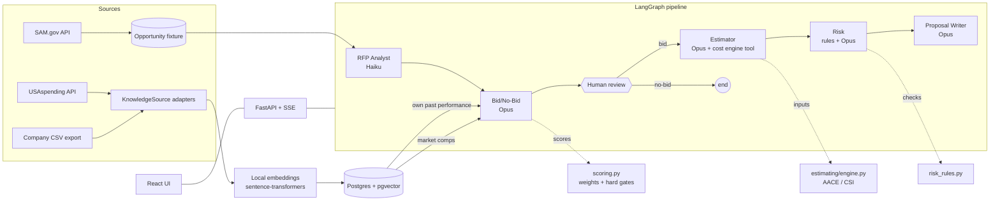

# BidSmith

**A multi-agent bid/no-bid and proposal assistant for commercial real estate firms pursuing public-sector work.**

BidSmith pulls federal construction and leasing opportunities from SAM.gov. It decides whether a company should pursue each one, based on the company's own award history, and produces a conceptual cost estimate and a risk register. It then drafts a first-pass proposal. A human approves or overrides the bid decision before any estimating or drafting happens.

The demo profile is built around **Ryan Companies** (Minneapolis), using its public federal award history from USAspending.gov. Peer firms supply market comparables. The knowledge base is **swappable**: any company can plug in its own project data through an adapter and a profile file.

> Portfolio project. Not affiliated with Ryan Companies or any other firm named here. Sample opportunities and cost data are illustrative. See [Data](#data).

---

## What makes it interesting

- **LLMs read and write; code does the math.** The bid score, every cost figure, and the risk scores are computed in plain Python. Agents choose inputs and explain them. The writer can't even type a dollar amount: it emits `{{TOTAL}}`-style tokens that code fills in.
- **Industry-standard estimating method.** Conceptual estimates follow the AACE classification (Class 5 when the building size is assumed, Class 4 when it's stated). Costs are split across CSI MasterFormat divisions, with location, escalation and requirement premiums applied.
- **Grounded, checkable evidence.** Every bid criterion cites project IDs from the knowledge base. Any ID the model didn't actually receive is dropped.
- **An ownership rule for past performance.** A proposal may cite only the bidding company's own projects. Other firms' awards are used as market intelligence only. This is enforced in the retrieval layer, then re-checked after the writer runs.
- **Human in the loop.** LangGraph pauses after the bid/no-bid recommendation. The user approves or overrides it before anything else happens.
- **Swap the company, keep the system.** The Compare view runs the same opportunity for two companies, e.g. Ryan versus a fictional small business, and shows different decisions with different evidence.
- **Cost-aware.** Token usage and API cost are tracked per agent and shown for every run.

## Architecture



| Agent | Model | Output | What code does around it |
|---|---|---|---|
| RFP Analyst | `claude-haiku-5-5` | `RfpAnalysis` (structured) | Fills location from SAM metadata |
| Bid/No-Bid | `claude-opus-5-5` | 0–5 score + rationale + evidence per criterion | Retrieval, computed facts, weighted total, hard gates (set-aside, bonding, deadline), invalid evidence removed |
| Human review | — | approve / override + note | LangGraph `interrupt()` |
| Estimator | `claude-opus-5-5` | tool calls to `run_estimate` | All arithmetic; AACE class and range; CSI split |
| Risk | `claude-opus-5-5` | qualitative risks | Deterministic checks (deadline, bonding, region, magnitude, comps, missing past performance) |
| Proposal Writer | `claude-opus-5-5` | sections + citations + placeholders | Price tokens filled, citations restricted to own projects |

Models are set in `.env` (`MODEL_FAST`, `MODEL_SMART`). Claude is called through the official `anthropic` SDK: `messages.parse` with Pydantic models for structured output, and a manual tool-use loop for the estimator. LangGraph handles orchestration, state and checkpointing.

## Quick start

Requirements: Python 3.11+, Node 18+, Docker.

```bash
git clone https://github.com/hafsabits/BidSmith && cd BidSmith
make setup          # creates .venv, installs backend + frontend, copies .env.example to .env
```

Add your `ANTHROPIC_API_KEY` to `.env`. Then:

```bash
make db-up          # Postgres + pgvector in Docker
make init-db        # tables + vector index
make ingest         # pulls USAspending awards for each profile and embeds them locally
make test           # unit + graph + API tests (no API key needed)
```

Run the app in two terminals:

```bash
make api            # FastAPI on :8000
make web            # React on :5173
```

Or run one opportunity from the command line:

```bash
.venv/bin/bidsmith run SAMPLE-001 --profile ryan
```

### Real SAM.gov opportunities

The repo ships 10 **illustrative sample** opportunities (IDs start with `SAMPLE-`) so it runs without a key. To pull real ones, get a free API key from your SAM.gov account settings, put it in `.env` as `SAM_API_KEY`, and run:

```bash
make fetch-sam
```

## Bring your own company

1. Add `config/profiles/<id>.yaml` with your regions, NAICS codes, core building types, bonding capacity, set-aside eligibility, and (optionally) criteria weights.
2. Point `sources:` at your data:
   ```yaml
   sources:
     - type: csv                         # your ERP/CRM export
       path: data/samples/my_projects.csv
     - type: usaspending                 # and/or your public federal awards
       recipient_names: ["MY COMPANY INC"]
   ```
3. `bidsmith ingest --profile <id>`

For another system (SharePoint, Procore, a data warehouse), implement the `KnowledgeSource` protocol in `backend/src/bidsmith/ingest/adapters/` and register it in `build_source`.

`config/profiles/acme.yaml` is a fictional small business backed by a CSV. It shows this path end to end.

## Data

| Data | Source | Notes |
|---|---|---|
| Past awards | [USAspending.gov API](https://api.usaspending.gov) | Real public contract awards. Descriptions are short, so the writer uses placeholders rather than inventing details. |
| Opportunities | [SAM.gov Get Opportunities API](https://open.gsa.gov/api/get-opportunities-public-api/) | Bundled `SAMPLE-*` notices are illustrative, not real solicitations. |
| Unit costs, CSI splits, location factors, escalation, premiums | `data/cost/*.csv` | **Synthetic.** Shaped like commercial square-foot cost models. A real firm would replace these with licensed data (e.g. RSMeans) using the same columns. |
| Bonding capacities in profiles | `config/profiles/*.yaml` | Illustrative assumptions. |

## Project layout

```
backend/src/bidsmith/
  schemas.py              Pydantic contracts shared by ingest, agents, API
  ingest/adapters/        KnowledgeSource adapters (USAspending, CSV)
  retrieval.py            pgvector search with the ownership rule
  estimating/engine.py    AACE Class 5/4 conceptual estimate by CSI division
  scoring.py              weighted bid score + hard gates
  risk_rules.py           deterministic risk checks
  llm.py                  Anthropic SDK wrapper: structured output, tool loop, usage/cost
  graph/                  LangGraph state, nodes, build, runner
  api/                    FastAPI + SSE run manager
frontend/src/pages/       Opportunities, Run, Knowledge Base, Compare
config/profiles/          company profiles (swap point)
data/                     cost tables, sample opportunities, sample CSV
```

## Roadmap

- Monte Carlo cost ranges (P50/P80) over the engine's inputs
- Compliance matrix built from the solicitation's instructions and evaluation criteria (Sections L and M)
- Parse full solicitation PDFs from SAM.gov attachments
- BLS Producer Price Index for escalation instead of fixed rates
- Labeled evaluation set: hand-labeled bid/no-bid decisions, with agreement tracked as prompts change
- Persistent checkpointer (Postgres) and deployment to GCP (Cloud Run + Cloud SQL, Vertex AI embeddings)
